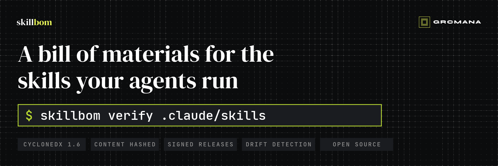

<p align="center">
  
</p>

# SkillBOM

**A bill of materials for the skills your agents run.**

SkillBOM produces a verifiable bill of materials for [Agent Skills](https://agentskills.io): what's in each skill, what it was built from, and whether what you installed is what was released. It's a [CycloneDX 1.6](https://cyclonedx.org) profile plus a small CLI, so the output opens in the SBOM tooling you already use.

> **Status: experimental (v0.0.x).** The profile and CLI may change. Feedback is very welcome in issues.

## Why

Skills steer what an AI agent does. Installing one is a supply-chain decision, but today it's hard to answer basic questions:

- Which version of this skill do I have, and has anyone changed it since release?
- Which knowledge or reference material is it relying on, and how old is it?
- Does it ship executable scripts?
- What evidence backs it?

Existing AI-BOMs describe models, datasets and MCP servers. At most they list a skill with its source and hash. SkillBOM treats the skill as a unit of supply in its own right:

| A Skill BOM records | How |
|---|---|
| Identity | Name, version, licence, author from `SKILL.md` |
| Integrity | A content hash of the whole skill folder, plus every file's hash |
| Knowledge provenance | Each reference file as a dependency, with its `as_of` date, deduplicated across skills |
| Capabilities | Each file's role (instructions, reference, asset, script); declared `allowed-tools` |
| Evidence | Reserved for profile 0.2: eval results pinned to the content hash they ran against |

## What it does not claim

- A Skill BOM records what a skill **is**, not that it is correct, safe or effective.
- A signature proves **who produced the BOM and that it hasn't changed since**. It doesn't prove the contents are true.
- `as_of` dates are declared by skill authors. SkillBOM records them and flags old ones; it doesn't verify them.

## Install

Python 3.10+, no dependencies. Until a package is published, run it from a clone:

```sh
git clone https://github.com/grcmana/skillbom && cd skillbom
pip install .          # or: PYTHONPATH=src python -m skillbom --help
```

## Use

### Generate a BOM for a skills repository

```sh
skillbom generate path/to/skills-repo \
  --name my-skills --version v1.2.0 \
  --repo-url https://github.com/owner/my-skills \
  -o skillbom.cdx.json
```

It finds every folder containing a `SKILL.md`. Output is deterministic: the same input gives a byte-identical BOM. Set `SOURCE_DATE_EPOCH` (e.g. to the release commit time) to include a reproducible timestamp.

### Check it against a policy

```sh
skillbom check skillbom.cdx.json
```

```
WARN   knowledge-freshness          knowledge:soc2@sha256:59ce901e1fff: as_of 2026-10-29 is 215 days old (limit 183)
PASS: 0 error(s), 1 warning(s)
```

Rules cover versions, hashes, licences, name/folder consistency, required metadata and knowledge freshness. Override severities with a JSON policy:

```json
{ "rules": { "knowledge-freshness": { "severity": "error", "max_age_days": 90 } } }
```

```sh
skillbom check skillbom.cdx.json --policy policy.json --json
```

### Verify what you installed

```sh
skillbom verify .claude/skills --bom skillbom.cdx.json
```

```
MODIFIED      dpia
    added    scripts.sh
    changed  SKILL.md
OK            risk-register
FAIL: 1 matching, 1 drifted or unknown
```

Installing a subset is normal, so skills in the BOM but not installed are ignored unless you pass `--require-all`. Exit codes: `0` pass, `1` policy failure or drift, `2` bad input.

## Verify a signed BOM

Releases of this repository are signed with keyless [GitHub artifact attestations](https://docs.github.com/en/actions/security-for-github-actions/using-artifact-attestations) (Sigstore). To check a downloaded file came from this repository's release workflow:

```sh
gh attestation verify grcskills-v0.1.0.cdx.json --repo grcmana/skillbom
```

To sign your own Skill BOM, add a step like this to your release workflow (needs `id-token: write` and `attestations: write`):

```yaml
- run: skillbom generate . --name my-skills --version ${{ github.ref_name }} -o skillbom.cdx.json
- uses: actions/attest@v4
  with:
    subject-path: skillbom.cdx.json
```

## Worked example

[`examples/grcskills-v0.1.0.cdx.json`](examples/grcskills-v0.1.0.cdx.json) is the Skill BOM for [GRC Skills](https://github.com/grcmana/grcskills) v0.1.0: 11 skills sharing 11 knowledge files. CI regenerates it from the public release on every change and fails if a single byte differs.

## Specification

[`SPEC.md`](SPEC.md) defines the profile: field mapping, the `skillbom:` property namespace, the hashing method (reproducible with `find`, `sort` and `sha256sum`), and the planned evidence model.

## Related work

SkillBOM complements, rather than replaces, the CycloneDX ML-BOM, the SPDX 3.0 AI profile, OWASP's Agent BOM work and AI-BOM generators such as cdxgen. Those describe models, agents and services; this describes the skill. If you maintain one of them and see overlap, please open an issue: alignment is better than another format.

## Part of a wider effort

SkillBOM is maintained by [GRCMANA](https://github.com/grcmana) and is neutral: it works with any Agent Skills repository. It sits alongside:

- [GRC Skills](https://grcskills.io): expert-written skills for GRC agents (the first adopter)
- [GRC Evals](https://grcevals.io): open GRC test cases with known answers (coming later)

## Licence

Code: [Apache-2.0](LICENSE). Specification (`SPEC.md`): [CC-BY-4.0](https://creativecommons.org/licenses/by/4.0/).
